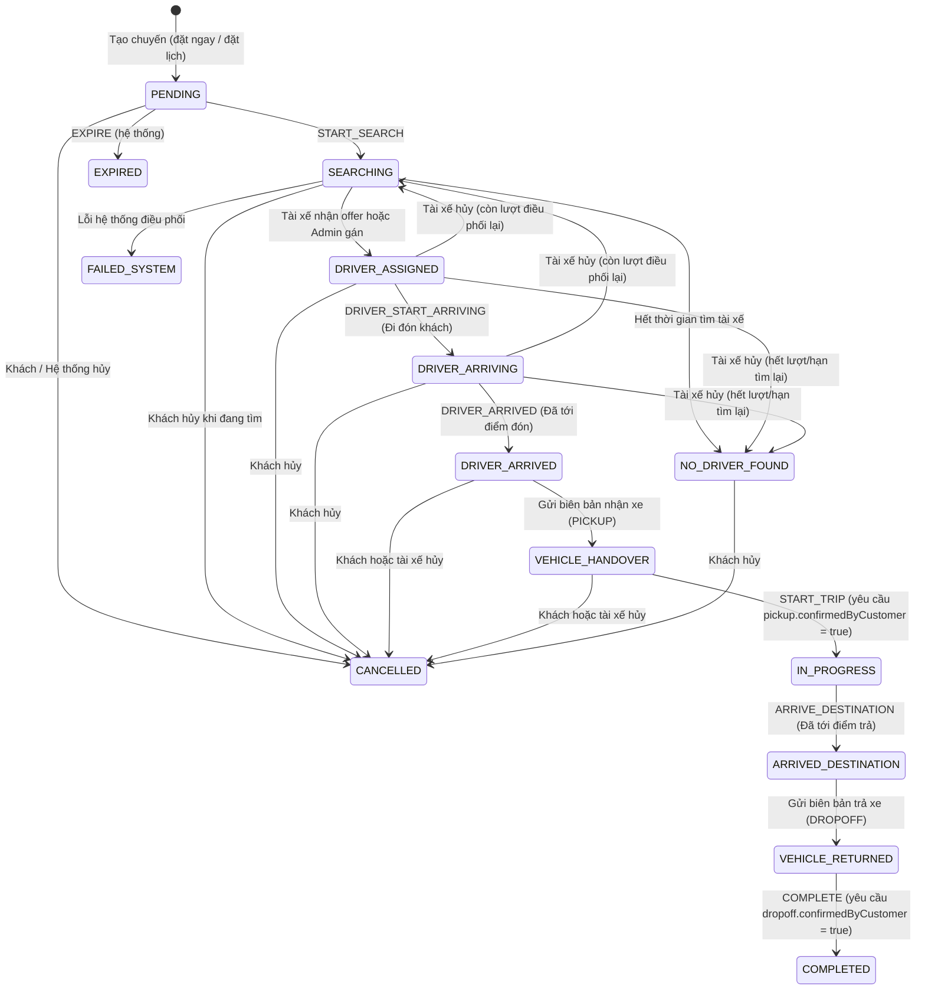

# Vòng đời chuyến đi và Ma trận UI/UX cho tài xế (`apps/driver`)

Tài liệu chuẩn hóa vòng đời chuyến đi theo một nguồn sự thật duy nhất ở **Spring Boot backend** (`RideStatus`, `RideStatusTransitions`, `RideStateMachine`, `RideHandoverService`, `HandoverCorrectionService`, `RideAcceptanceService`, `PaymentService`, `RideQueryService`, `RideRatingService`) và lớp presentation state-driven tại `apps/driver/src/features/ride/ridePresentation.ts`.

---

## 1. Sơ đồ vòng đời chuyến đi thực tế (Backend State Machine)

> **Ghi chú quy trình Backend:**
> - **Không cho phép tài xế hoặc khách hủy** khi chuyến đã ở trạng thái `IN_PROGRESS`, `ARRIVED_DESTINATION`, `VEHICLE_RETURNED` (`RideStatusTransitions.kt`).
> - Khi `PICKUP` hoặc `DROPOFF` đã gửi nhưng khách gửi yêu cầu điều chỉnh (`correctionReason != null && !confirmedByCustomer`), tài xế gửi bản sửa qua `POST /driver/rides/{id}/handover/{phase}/revisions` với đúng `revision` hiện tại; `correctionReason` chỉ xóa sau khi gửi bản sửa thành công.
> - Ngay khi `COMPLETE` commit, `PaymentService.onRideCompleted` quyết toán ví/chiết khấu:
>   - `WALLET`: trừ ví khách, cộng `TRIP_EARNING` vào ví tiền mặt tài xế và ghi `payments.status = PAID`. Nếu ví khách không đủ tại thời điểm hoàn tất, backend tự chuyển sang `CASH` (`status = PENDING`).
>   - `CASH`: trừ `COMMISSION_FEE` ở ví tín dụng tài xế và tạo `payments(method = CASH, status = PENDING)`. Tài xế thu đủ tiền mặt và xác nhận `POST /driver/rides/{id}/payment/cash/confirm` -> `PAID`.

---

## 2. Các trạng thái phụ đi kèm (Backend)

| Thực thể | Các trạng thái | Ràng buộc và tác động lên UI Driver |
| --- | --- | --- |
| **Tài xế (`DriverStatus`)** | `OFFLINE`, `ONLINE`, `BUSY`, `BLOCKED` | Nhận chuyến thành công -> `BUSY`. Hủy/điều phối lại/hoàn tất -> giải phóng `BUSY -> ONLINE` (và evict `AuthenticatedUserCache`). `BLOCKED` hoặc thiếu hạn mức tín dụng -> chặn bật nhận chuyến và ẩn nhận offer mới. Nếu `session.status === 'BUSY'` nhưng `activeRide === null` trong tích tắc đồng bộ, Home phải hiển thị trạng thái đang đồng bộ, không hiển thị nút `Bật nhận chuyến` giả. |
| **Biên bản (`PICKUP` / `DROPOFF`)** | Chưa tạo · Đã tạo (`confirmedByCustomer = false`, `correctionReason = null`) · Cần điều chỉnh (`correctionReason != null`, `!confirmedByCustomer`) · Đã xác nhận (`confirmedByCustomer = true`) | Chỉ được tạo `PICKUP` ở `DRIVER_ARRIVED`; chỉ được sửa `PICKUP` ở `VEHICLE_HANDOVER` khi `correctionReason != null && !confirmedByCustomer`. Chỉ được tạo `DROPOFF` ở `ARRIVED_DESTINATION` (có đối chiếu `dropoff.odometer >= pickup.odometer`); chỉ được sửa `DROPOFF` ở `VEHICLE_RETURNED` khi `correctionReason != null && !confirmedByCustomer`. Chỉ mở nút xem biên bản khi bản ghi thực sự tồn tại. |
| **Thanh toán (`PaymentStatus`)** | `PENDING`, `PAID`, `FAILED`, `REFUNDED` | Trên `OfferDecision` (`SEARCHING`), không bao giờ hiển thị `"Đã trả qua ví"` khi mới biết `paymentMethod = WALLET` mà chưa xác nhận `paymentStatus === 'PAID'`. Sau `COMPLETED`, nút `Xác nhận đã nhận tiền mặt` chỉ hiện khi `method === 'CASH' && status === 'PENDING'`. |

---

## 3. Ma trận UI/UX chi tiết theo từng trạng thái

| Trạng thái API + Điều kiện | Tiêu đề màn hình | Thông báo trạng thái | Thông tin cần hiển thị | Primary CTA | Secondary actions | Hành động phải ẩn | Hành động disabled & Lý do | Đích chỉ đường | Hiển thị biên bản | Hành vi mất mạng / `!synchronized` |
| --- | --- | --- | --- | --- | --- | --- | --- | --- | --- | --- |
| **PENDING** | *(Không vào màn chuyến active)* | Chờ đến cửa sổ điều phối (chuyến đặt lịch) | Không có card active cho tài xế | — | — | Toàn bộ thao tác chuyến | — | Không | Không | Giữ Home đồng bộ |
| **SEARCHING** *(có offer còn hạn)* | Màn `Nhận chuyến` (`AcceptScreen`) | Yêu cầu chuyến mới kèm đồng hồ đếm ngược 25s (+2s margin) | Thu nhập ước tính (`tabular-nums`), loại xe + hộp số, phương thức thanh toán (`Thu tiền mặt` / `Thanh toán qua ví`), tổng phút/km, điểm đón & điểm trả đầy đủ | `Nhận chuyến` | `Bỏ qua` (tách biệt phía trên) | Thao tác thực hiện chuyến, xem biên bản, hủy chuyến | `Nhận chuyến` / `Bỏ qua` disabled khi `busy` hoặc `secondsLeft <= 0` ("Hết thời gian phản hồi") | Bản đồ xem trước tuyến trong `AcceptScreen` | Không | Báo lỗi kết nối + giữ nút `Kiểm tra lại` / `Về trang chủ` khi offer lỗi/hết hạn |
| **DRIVER_ASSIGNED** | `Chuẩn bị đón khách` *(Bước 1/4)* | Sẵn sàng di chuyển tới điểm đón khách | Mã chuyến, badge trạng thái, bản đồ tới điểm đón, Điểm đón (`pickupNote`), Điểm trả, thông tin xe (`vehicleSnapshot`, `vehicleType`, biển số), cước dự kiến, thanh toán, thẻ khách | `Đi đón khách` (`start-arriving`) | Chỉ đường Goong tới điểm đón, Nhắn tin/Gọi khách, Làm mới, An toàn, Trợ giúp, `Hủy chuyến` (có lý do) | Xem/lập biên bản nhận xe, biên bản trả xe, `Đã tới điểm đón`, `Bắt đầu chuyến đi` | — | **`pickup`** | Không (chưa tồn tại) | Giữ thông tin chuyến; ẩn/khóa CTA & chỉ đường & hủy; banner *"Chưa đồng bộ được chuyến. Làm mới để tiếp tục."* |
| **DRIVER_ARRIVING** | `Đang đến điểm đón` *(Bước 1/4)* | Đang di chuyển tới điểm đón | Mã chuyến, bản đồ tới điểm đón, Điểm đón (`pickupNote`), Điểm trả, xe khách, cước, thẻ khách | `Đã tới điểm đón` (`arrived`) | Chỉ đường Goong tới điểm đón, Nhắn tin/Gọi khách, Làm mới, An toàn, Trợ giúp, `Hủy chuyến` | Xem/lập biên bản nhận xe, biên bản trả xe, `Bắt đầu chuyến đi` | — | **`pickup`** | Không (chưa tồn tại) | Giữ thông tin chuyến; khóa thao tác chuyển trạng thái & chỉ đường; hiện nút Làm mới |
| **DRIVER_ARRIVED** | `Đã tới điểm đón` *(Bước 2/4)* | Đã tới điểm đón · Lập biên bản nhận xe cùng khách | Nhắc kiểm tra xe và chụp tối thiểu 4 góc ảnh + ODO; thông tin điểm đón/trả (tĩnh), xe khách, thẻ khách | `Lập biên bản nhận xe` | Nhắn tin/Gọi khách, Làm mới, An toàn, Trợ giúp, `Hủy chuyến` | **Ẩn hoàn toàn nút chỉ đường tới điểm đón**, xem biên bản (chưa lập), `Bắt đầu chuyến đi`, biên bản trả xe | — | **Không** | Cho phép **lập mới `PICKUP`** trên `/ride/vehicle-inspection` (không có nút chỉ đường trên màn biên bản) | Trên màn chuyến: khóa thao tác + hiện banner đồng bộ. **Trên màn đang nhập biên bản**: **GIỮ NGUYÊN toàn bộ bản nháp (ODO/nhiên liệu/ghi chú/ảnh)**, hiện banner mất kết nối và disable nút Gửi kèm lý do |
| **VEHICLE_HANDOVER** *(chưa confirm, không có `correctionReason`)* | `Chờ xác nhận nhận xe` *(Bước 2/4)* | Khách hàng đang kiểm tra và xác nhận biên bản nhận xe trên ứng dụng khách | Tóm tắt chờ xác nhận từ khách, tóm tắt lộ trình sắp đi, xe khách, thẻ khách | — *(Footer giải thích lý do khóa `Bắt đầu chuyến đi` + nút kiểm tra xác nhận)* | `Xem biên bản nhận xe`, `Kiểm tra xác nhận` (refetch), Nhắn tin/Gọi khách, An toàn, Trợ giúp, `Hủy chuyến` | **Ẩn chỉ đường điểm đón**, `Bắt đầu chuyến đi` khi chưa confirm, `Sửa biên bản`, biên bản trả xe | `Bắt đầu chuyến đi` chưa mở vì *"Khách chưa xác nhận biên bản nhận xe"* | **Không** | Chỉ **xem lại `PICKUP`** (read-only) | Giữ ngữ cảnh chuyến và bản đã xem; khóa Hủy & cập nhật đến khi đồng bộ |
| **VEHICLE_HANDOVER** *(`correctionReason != null`, `!confirmedByCustomer`)* | `Cần sửa biên bản nhận xe` *(Bước 2/4)* | Khách yêu cầu điều chỉnh biên bản nhận xe *(kèm lý do & ảnh từ khách)* | Lý do điều chỉnh của khách, ảnh đối chiếu (nếu có), xe khách, thẻ khách | `Sửa biên bản nhận xe` | `Xem phiên bản trước`, Nhắn tin/Gọi khách, Làm mới, An toàn, Trợ giúp, `Hủy chuyến` | `Bắt đầu chuyến đi`, chỉ đường điểm đón, biên bản trả xe | — | **Không** | Mở **chỉnh sửa `PICKUP` revision mới** trên `/ride/vehicle-inspection` | Trong form sửa: giữ nguyên draft sửa đã nhập khi rớt mạng; khóa gửi cho đến khi đồng bộ |
| **VEHICLE_HANDOVER** *(`confirmedByCustomer === true`)* | `Sẵn sàng khởi hành` *(Bước 2/4)* | Khách đã xác nhận biên bản nhận xe · Có thể bắt đầu chuyến | Banner xanh xác nhận sẵn sàng, thông tin lộ trình, xe khách, thẻ khách | `Bắt đầu chuyến đi` (`start`) | `Xem biên bản nhận xe`, Nhắn tin/Gọi khách, Làm mới, An toàn, Trợ giúp, `Hủy chuyến` | Chỉ đường điểm đón, `Sửa biên bản nhận xe`, biên bản trả xe | — | **Không** *(chờ bấm `Bắt đầu chuyến đi` sang `IN_PROGRESS`)* | Chỉ **xem lại `PICKUP`** | Khóa `Bắt đầu chuyến đi` khi `!synchronized`; giữ nguyên dữ liệu |
| **IN_PROGRESS** | `Đang thực hiện chuyến` *(Bước 3/4)* | Đang di chuyển tới điểm trả · Chỉ thao tác khi dừng xe an toàn | Bản đồ tới điểm trả, **Điểm trả nổi bật** (+ nút chỉ đường trả), tóm tắt điểm đón đã qua, xe, cước, thẻ khách | `Đã tới điểm trả` (`arrive-destination`) | Chỉ đường Goong tới điểm trả, `Xem biên bản nhận xe` (nếu có), Nhắn tin/Gọi khách, Làm mới, An toàn, Trợ giúp | **Tất cả hành động đón khách cũ**, **`Hủy chuyến`** (backend cấm ở pha này), biên bản trả xe | — | **`dropoff`** | Chỉ **xem `PICKUP` nếu có** | Giữ ngữ cảnh lộ trình; khóa `Đã tới điểm trả` & chỉ đường khi `!synchronized` |
| **ARRIVED_DESTINATION** | `Đã tới điểm trả` *(Bước 4/4)* | Đã tới điểm trả · Lập biên bản trả xe | Hướng dẫn kiểm tra xe, nhập ODO ≥ ODO nhận xe và chụp đủ ảnh trả xe; tóm tắt tại điểm trả, thẻ khách | `Lập biên bản trả xe` | `Xem biên bản nhận xe` (để đối chiếu ODO/tình trạng), Nhắn tin/Gọi khách, Làm mới, An toàn, Trợ giúp | **Ẩn chỉ đường tới điểm trả**, **`Hủy chuyến`**, `Hoàn tất chuyến`, xem biên bản trả xe (chưa lập) | — | **Không** | Cho phép **lập mới `DROPOFF`** trên `/ride/vehicle-inspection` (không hiện nút chỉ đường) | Trên form nhập biên bản trả xe: **GIỮ NGUYÊN bản nháp khi mất mạng**, hiển thị lỗi đồng bộ & khóa gửi kèm lý do |
| **VEHICLE_RETURNED** *(chưa confirm, không có `correctionReason`)* | `Chờ xác nhận trả xe` *(Bước 4/4)* | Khách hàng đang kiểm tra và xác nhận biên bản trả xe trên ứng dụng khách | Tóm tắt chờ khách xác nhận, thanh toán dự kiến (`CASH`/`WALLET`), thẻ khách | — *(Footer giải thích lý do khóa `Hoàn tất chuyến` + nút kiểm tra xác nhận)* | `Xem biên bản trả xe`, `Xem biên bản nhận xe` (nếu có), `Kiểm tra xác nhận`, Nhắn tin/Gọi khách, An toàn, Trợ giúp | Chỉ đường, **`Hủy chuyến`**, `Hoàn tất chuyến` khi chưa confirm | `Hoàn tất chuyến` chưa mở vì *"Khách chưa xác nhận biên bản trả xe"* | **Không** | Chỉ **xem `PICKUP` / `DROPOFF`** (read-only) | Giữ ngữ cảnh; khóa thao tác ghi đến khi đồng bộ |
| **VEHICLE_RETURNED** *(`correctionReason != null`, `!confirmedByCustomer`)* | `Cần sửa biên bản trả xe` *(Bước 4/4)* | Khách yêu cầu điều chỉnh biên bản trả xe *(kèm lý do & ảnh từ khách)* | Lý do khách yêu cầu sửa, ảnh đối chiếu | `Sửa biên bản trả xe` | `Xem biên bản nhận xe`, Nhắn tin/Gọi khách, Làm mới, An toàn, Trợ giúp | `Hoàn tất chuyến`, chỉ đường, `Hủy chuyến` | — | **Không** | Mở **chỉnh sửa `DROPOFF` revision mới** | Giữ draft sửa khi mất mạng; khóa nút Gửi đến khi đồng bộ |
| **VEHICLE_RETURNED** *(`confirmedByCustomer === true`)* | `Sẵn sàng hoàn tất` *(Bước 4/4)* | Khách đã xác nhận trả xe · Bấm hoàn tất để kết toán chuyến | Banner xanh xác nhận sẵn sàng hoàn tất, thông tin thanh toán dự kiến, thẻ khách | `Hoàn tất chuyến` (`complete`) | `Xem biên bản trả xe`, `Xem biên bản nhận xe`, Nhắn tin/Gọi khách, Làm mới, An toàn, Trợ giúp | Chỉ đường, `Hủy chuyến`, `Sửa biên bản trả xe` | — | **Không** | Chỉ **xem `PICKUP` / `DROPOFF`** | Khóa `Hoàn tất chuyến` khi `!synchronized`; giữ dữ liệu |
| **COMPLETED** | `Chi tiết chuyến` / `Hoàn tất chuyến` | Trạng thái thanh toán rõ ràng: `CASH PENDING` (*Thu tiền mặt · Chờ xác nhận*), `CASH PAID` (*Đã thu đủ*), `WALLET PAID` (*Đã trả qua ví*), `WALLET FAILED/PENDING/REFUNDED` | Biên lai thu nhập ròng + chiết khấu, tổng cước, quãng đường, phương thức & thời gian thanh toán, thẻ đánh giá khách (`driverHasRatedCustomer`), lộ trình tóm tắt, biên bản thực có (ảnh thu gọn mặc định), mốc thời gian | **`Xác nhận đã nhận tiền mặt`** *(CHỈ hiện khi `payment.method === 'CASH' && payment.status === 'PENDING'`)* | Gửi/bỏ qua đánh giá khách, mở rộng xem ảnh biên bản thực có, `Trợ giúp về chuyến này` | Mọi CTA điều phối/lái xe, chỉ đường, `Hủy chuyến`, lập/sửa biên bản | `Gửi đánh giá` disabled khi chưa chọn số sao | **Không** | Chỉ hiển thị biên bản **thực sự tồn tại** (read-only) | Giữ dữ liệu đã tải; khóa nút xác nhận tiền nếu đang lỗi/offline + nút Thử lại |
| **CANCELLED** | `Chi tiết chuyến` *(hoặc Banner kết thúc trên `InProgress`)* | Ghi rõ bên hủy (`Khách hủy` / `Tài xế hủy` / `Hệ thống hủy`) và lý do hủy | Mã chuyến, badge `Đã hủy`, lý do hủy, lộ trình, biên bản nếu từng lập trước lúc hủy, mốc thời gian | *(Nếu đang ở `InProgressScreen`)* `Về trang chủ` | `Xem chi tiết chuyến` (nếu có quyền), `Trợ giúp về chuyến này` | Toàn bộ CTA vận hành, chỉ đường, `Hủy chuyến`, lập/sửa biên bản, xác nhận tiền, đánh giá | — | **Không** | Chỉ hiện biên bản đã tồn tại trước khi hủy (nếu có) | Giữ dữ liệu chi tiết nếu đã có + nút Thử lại |
| **NO_DRIVER_FOUND / EXPIRED / FAILED_SYSTEM** | `Chi tiết chuyến` / `Kết thúc điều phối` | Kết thúc điều phối do không tìm được tài xế / quá hạn / lỗi hệ thống | Trạng thái chuyến nếu tài khoản có quyền xem | `Về trang chủ` | `Trợ giúp về chuyến này` | Toàn bộ CTA vận hành, chỉ đường, lập/sửa biên bản, đánh giá | — | **Không** | Không | Hiện lỗi tải + nút Thử lại / Về trang chủ |

---

## 4. Nguyên tắc xử lý mất mạng & biên bản trong app
1. **Không làm mất bản nháp:** `useVehicleInspection` lưu ODO, nhiên liệu, ghi chú, danh sách ảnh đã upload và ảnh `pending` chưa upload theo key `['driverDraft', 'handover', uid, scope]`. Khi `query.isError` hoặc `query.isPaused` xảy ra trong lúc tài xế đang nhập ở `DRIVER_ARRIVED` / `ARRIVED_DESTINATION` / `revise`, form **vẫn giữ nguyên trên màn hình**; chỉ nút Gửi bị khóa kèm thông báo đồng bộ.
2. **Chuyển pha ngoài ý muốn khi đang mở màn phụ:**
   - Nếu khách hủy chuyến hoặc chuyến hoàn tất khi tài xế đang đứng ở `InProgressScreen`: hook giữ lại `lastRideId`, gọi `getDriverRide(lastRideId)` để chuyển thẳng sang `/ride/complete` (nếu `COMPLETED`) hoặc hiển thị thông báo kết thúc kèm lý do hủy + CTA `Xem chi tiết` / `Về trang chủ`.
   - Nếu đang ở `RideDirectionsScreen` mà chuyến đổi pha (vd đã tới điểm đón hoặc bị hủy), ẩn map chỉ đường và hiển thị nút quay về đúng màn hình hợp lệ.
