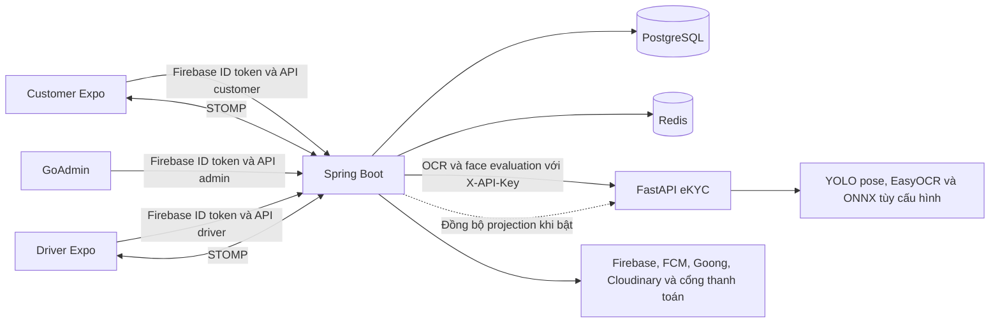

# Kiến trúc hệ thống PtitGo

PtitGo gồm bốn Git repo độc lập. Các đường dẫn dưới đây ghi nhận vị trí workspace hiện tại. Khi clone sang máy khác, cấu hình origin của từng service theo môi trường.

| Repo | Runtime và build | Điểm vào khi phát triển |
| --- | --- | --- |
| `datxe_rn` | Expo SDK 58, React Native, TypeScript, Node 22+, npm workspaces | Expo/Metro, `npm run customer` và `npm run driver` trong repo gốc |
| `datxebackend` | Kotlin, Spring Boot 4.1.2, Java 21, Gradle Wrapper | API HTTP cổng 8080, PostgreSQL 17, Redis 7 |
| `goAdmin` | React 19, TypeScript, Vite, Ant Design, React Query, Firebase Web SDK, pnpm 10.34.7 | Vite tại `localhost:5173` |
| `ekyc-service` | Python 3.11, uv, FastAPI, OpenCV, PyTorch CPU, Ultralytics, EasyOCR | Uvicorn cổng 8001. Workflow độc lập có thể lưu SQLite và ảnh được mã hóa |

## API và dữ liệu

- Customer và Driver dùng client chung cho xác thực, retry token và hợp đồng `ApiResponse`. Backend quản lý trạng thái chuyến, phân công tài xế, ví, thanh toán, hoàn tiền và phân quyền. Mobile cập nhật từ HTTP và sự kiện STOMP. GoAdmin dùng các API quản trị với role lấy từ backend.
- Các API danh sách chính trả `content`, `page`, `size`, `totalElements`, `totalPages` và `hasNext`. Dùng số nguyên VND, thời điểm ISO-8601 UTC và ngày lịch `YYYY-MM-DD`. API xác minh có envelope và mã lỗi riêng. Đối chiếu DTO và test của hai đầu khi đổi contract.
- Driver và GoAdmin dùng origin Spring Boot cho xác minh. Driver mở hồ sơ tại `/profile/verification`. GoAdmin duyệt tại `/driver-documents/verification`. Backend quản lý revision, khóa danh tính và xét quyền theo hồ sơ, rồi gọi `/ekyc/documents/{slot}/extract` và `/ekyc/face/evaluate`. Các đường dẫn xác minh của backend tương thích cả nhóm `/api/.../verification/v1` và các route `/ekyc/driver-verification/v1` đang được consumer dùng. Luồng đồng bộ projection độc lập chỉ hoạt động khi được cấu hình và dùng quyết định đã xác thực. Projection bản địa có quyền ưu tiên.
- Firebase client config, `EXPO_PUBLIC_*` và `VITE_*` có thể xuất hiện trong bundle. Lưu private key ký app, Firebase service account, credential thanh toán, khóa eKYC và khóa lưu trữ ở phía server hoặc trong môi trường build riêng. Giữ ảnh hồ sơ, dữ liệu sinh trắc học, DB dump và model chưa được duyệt phân phối ngoài Git.

| Consumer | Contract cần giữ khi phát hành |
| --- | --- |
| Customer → Backend | `POST /api/customer/rides` nhận lựa chọn lộ trình, xe và thanh toán. Cùng `Idempotency-Key` và body có thể retry. Nhóm `/api/customer/rides/{rideId}/payment` đọc trạng thái thanh toán từ backend. |
| Driver → Backend | `GET /api/driver/offers/pending` và `POST /api/driver/offers/{rideId}/accept` dùng Firebase driver role. API xác minh trả trạng thái và revision hồ sơ. |
| GoAdmin → Backend | `POST /api/admin/rides/{id}/assignable-drivers` nhận mảng ID và trả mảng ID hợp lệ. `POST /api/admin/withdrawals/{id}/review` dùng quyền admin và quyết định đã xác nhận. |
| Backend → eKYC inference | `POST /ekyc/documents/{slot}/extract` và `POST /ekyc/face/evaluate` dùng `X-API-Key`. Client backend xử lý timeout, unavailable và mã kết quả theo chức năng. |
| Backend → eKYC projection tùy chọn | `GET /ekyc/driver-verification/v1/internal/decision-head` và `GET .../decision-events?after={cursor}` dùng `X-Verification-Sync-Key` và cập nhật theo cursor/revision. |

## Thiết lập trên máy mới

1. Mở README của từng repo. Cài Java 21, Docker, Node phù hợp cho từng frontend, pnpm 10.34.7, Python 3.11/uv và SDK Android hoặc Xcode nếu chạy mobile native.
2. Chuẩn bị `.env` backend từ mẫu bằng credential của môi trường dev/test. Khởi động PostgreSQL và Redis riêng cho môi trường đó. Backend chạy Flyway khi khởi động.
3. Cài eKYC từ `uv.lock`. Khôi phục artifact theo manifest và checksum trong tài liệu staging của eKYC. Dùng `/health` và `/health/ready` để kiểm tra trước khi bật `DATXE_EKYC_ENABLED` và đặt `DATXE_EKYC_ORIGIN`. Cấu hình cùng khóa nội bộ ở hai service. Chỉ bật face hoặc verification projection sau khi chuẩn bị đúng manifest và cấu hình.
4. Khởi động backend rồi kiểm tra `/actuator/health`. Dùng Firebase project test chung cho backend, mobile và GoAdmin. Điền `EXPO_PUBLIC_API_URL` cho từng app và `VITE_API_BASE_URL` cho GoAdmin từ các mẫu hiện có. Thiết bị Android cần origin mà chính thiết bị truy cập được. Thêm origin GoAdmin vào danh sách CORS backend nếu khác mặc định.
5. Cài mobile qua `npm ci` và GoAdmin qua `pnpm install --frozen-lockfile`. Chạy development build mobile nếu dùng module native. Chạy `pnpm dev` cho GoAdmin.

## Kiểm thử tích hợp

Chạy `npm run check` ở mobile, `./gradlew check build` với PostgreSQL dùng một lần ở backend, lint/typecheck/Vitest/build ở GoAdmin, và Ruff, pytest, test JavaScript cùng readiness smoke ở eKYC. Kiểm tra artifact bằng ảnh tổng hợp trên CPU trước khi chạy E2E.

Trong môi trường test tách biệt, kiểm tra đăng nhập và phân quyền ba vai trò, xác minh và duyệt revision hồ sơ tài xế, booking, điều phối, nhận/hủy chuyến, bàn giao và trả xe, ví/hoàn tiền, đánh giá, thông báo và các thao tác quản trị tương ứng. Kiểm tra request retry, tình huống mất mạng và eKYC không sẵn sàng. Dùng giao dịch mô phỏng hoặc sandbox và tài khoản test. Chụp Android Light/Dark và thử `font_scale 1.3` nếu xác nhận giao diện trên thiết bị.
